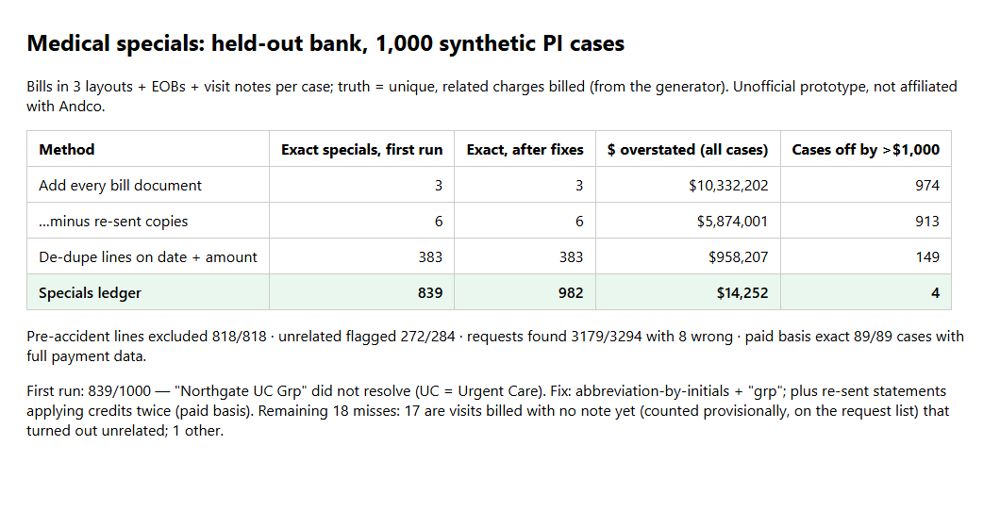

# Specials ledger: one number for the demand, every line traced to a page

Unofficial prototype by Kushagra Pratap Singh. Not affiliated with Andco.

## The problem
[Andco](https://www.useandco.com)'s agents retrieve medical records and bills for personal-injury firms. They "match bills to records" and tally the medical specials that anchor the demand letter; their example shows $64,150 in specials and a policy-limit demand.

The same charges reach a case file several times, in different shapes:
- an itemized bill;
- a UB-04 facility summary;
- a patient statement with a balance forward and insurance credits;
- the same fax re-sent, or a portal copy.

Statements also list care from **before the accident**, and some visits are **unrelated**: a wellness exam, a cholesterol recheck. Adding up documents overstates the specials. Getting the de-duplication wrong in the other direction understates them.

Lawyers are [asking how AI output is evaluated](https://linkedin.com/in/ryanxue). A specials number should say exactly which page each dollar came from.

## What I built
`specials` reads bill, UB-04, statement, EOB and visit-note text (as after extraction or OCR) and builds a **ledger of unique charges**:

1. **Provider resolution** across aliases:
   - NPI when present, else token matching with expansions ("St."/"Saint", "Med Ctr", "Assoc", "Mt.");
   - prefix and one-edit matching;
   - **abbreviations by initials** ("UC" = Urgent Care).
2. **De-duplication.**
   - The same provider, date, code and amount across documents is one charge, with every source listed.
   - Statement lines (with or without a code) fold into the itemized line.
   - A UB-04 summary whose total equals the itemized charges in its period is *not* added again; if the totals differ, it is flagged.
   - A re-sent copy is recognised, and its credits are not applied twice.
3. **Matching to visit notes**: same provider and same date, or ±1 day only when no note has the exact date and the note isn't another visit's.
4. **Status per charge**:
   - `INCLUDED`;
   - `EXCLUDED_PRE_ACCIDENT`;
   - `REVIEW_UNRELATED` (preventive CPT, unrelated ICD-10, or a note with no injury mention);
   - `NEEDS_RECORD` (billed, no note yet: counted provisionally and requested).
5. **Requests**: records to request, bills to request (a note with no charge), and treatment gaps of more than 30 days (or more than 14 days before the first visit) that the adjuster will raise.
6. **Totals**:
   - billed specials;
   - **paid basis** (billed minus contractual adjustments, from EOBs or statement credits), for states that limit recovery to amounts paid;
   - **liens** by payer.

## Result (held-out bank: 1,000 synthetic cases, committed to git before the first run)


| Method | Exact specials, first run | Exact after fixes | $ overstated (all cases) | Cases off by >$1,000 |
|---|---|---|---|---|
| Add every bill document | 3 | 3 | $10,332,202 | 974 |
| …minus re-sent copies | 6 | 6 | $5,874,001 | 913 |
| De-dupe lines on date + amount | 383 | 383 | $958,207 | 149 |
| **Specials ledger** | **839** | **982** | **$14,252** | **4** |

- Total true specials across the 1,000 cases: $9,518,713.
- **Exclusions:** pre-accident lines excluded 818/818; unrelated lines flagged 272/284.
- **Requests:** 3,179 of 3,294 found, with 8 wrong.
- **Paid basis:** exact on 89/89 cases that have full payment data.

**What changed after the first run:**
- **First run, 839/1,000.** One alias, "Northgate UC Grp", never resolved, so its documents were treated as an unknown provider.
  - **Fix:** match abbreviations by initials, and treat "Grp" as "Group". This is a general rule, not a lookup for that one name.
- **Paid basis.** A re-sent statement applied its credits twice.
  - **Fix:** recognise a repeated statement.
- **Kept unchanged:** the first run is in `out/heldout_first_run.json`, and the rerun is in `out/heldout.json`.

**The 18 remaining misses:**
- 17 are visits billed with no note yet that turned out to be unrelated. The ledger counts them provisionally and lists them on the request list, which is the right call until the note arrives.
- 1 is a different issue.

**Liens are exact in 69 of the 89 cases.** In the rest, part of the payments came only from statements, which don't name the payer. The ledger shows these as "payer not named", and an EOB request would close the gap.

### Example (`python demo.py`, abridged)
```
Case 90011: accident 2026-06-21, 30 documents {'RECORD': 20, 'ITEMIZED': 4, 'STATEMENT': 2, 'EOB': 2, 'UB04': 2}
  Peak Performance Physical Therapy
    2026-02-10 97110   182.00  EXCLUDED_PRE_ACCIDENT  src D17,D19  - date of service is before the accident 2026-06-21
    2026-08-01 97530   175.00  NEEDS_RECORD           src D17,D19  - billed, no visit note on file (counted provisionally)
NOTES  D28: same statement as one already read -> credits not applied twice
       D20: UB-04 summary 3,421.00 = itemized charges already counted -> not added again
REQUESTS  records: Peak Performance PT, DOS 2026-08-01 · bill: Peak Performance PT, DOS 2026-08-21 (seen in D16)
TOTALS  billed specials 7,961.00 (truth 7,961.00) · paid basis 6,081.97 · liens {'Medicaid (state plan)': 2461.4}
        quick tallies: add every bill 20,285.00 | drop re-sent 12,142.00 | de-dupe date+amount 8,143.00
```

## Honest limits
- **Synthetic data.** All cases are synthetic, and the layouts are mine, which keeps the parsing easy. Real bills need OCR and a layout model in front of this; the ledger logic starts after extraction.
- **Relatedness is screening, not a legal judgment.** It uses codes and note text. `REVIEW_UNRELATED` means "a person decides", and causation is the attorney's call.
- **Damages law is not encoded.** "Paid basis" is one generic number. State rules (billed vs paid, write-offs, Medicare/Medicaid specifics) aren't encoded, and this is not legal advice.
- **No real patient data and no Andco systems were used.**

## Run it (Python 3.10+, stdlib only)
```
python demo.py              # one held-out case: ledger, notes, requests, totals vs quick tallies
python evaluate.py          # held-out scores -> out/heldout.json   (--dev for the dev bank)
python -m pytest -q tests   # 7 tests
```

## Files
- `specials/ledger.py`: parsing, provider resolution, de-duplication, matching, status, totals, requests
- `specials/synth.py`: case generator (visits, layouts, EOBs, notes, noise) with truth
- `specials/baselines.py`: quick-tally baselines
- `eval/bank_heldout.py`: held-out bank, the first commit
